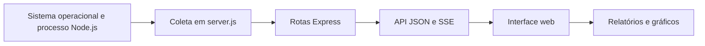

# 📊 NEXUS OS Omega V3 — Dashboard de monitoramento

Dashboard desenvolvido com **Node.js e Express** para acompanhar informações do sistema operacional, do processo Node.js e do próprio servidor HTTP. A interface está em português e apresenta indicadores que ajudam a observar o ambiente de execução.

**Versão declarada:** `3.1.0` · **Runtime:** Node.js 18 ou superior · **Dependências principais:** Express e Helmet.

## ✨ Recursos do dashboard

| Área | Informações e recursos disponíveis |
|---|---|
| CPU | Utilização média e por núcleo, modelo, frequência e histórico recente. |
| Memória | RAM total, disponível e utilizada; memória do processo Node.js, incluindo heap e RSS. |
| Sistema operacional | Plataforma, arquitetura, nome da máquina e tempo de atividade. |
| Runtime Node.js | Versões do Node.js e do V8, uso de heap, event loop e eventos de coleta de lixo. |
| Rede | Interfaces e endereços identificados pelo ambiente. |
| Requisições HTTP | Quantidade de requisições, duração média, classes de status e taxa de erros do serviço. |
| Processos | Consulta, filtro e ordenação dos processos que o ambiente permite visualizar. |
| Armazenamento e arquivos | Informações do volume, quando disponíveis, e análise dos arquivos do projeto. |
| Relatórios | Exportação e cópia de dados em JSON, comparação por importação e exportação de sessões em CSV. |

A interface oferece cinco temas, controle de efeitos visuais, tela cheia, pausa de atualização e uma paleta de comandos aberta com `Ctrl+K` ou `Cmd+K`. O monitor de processos funciona em **modo somente leitura**: não encerra processos.

## 🧱 Organização técnica

O arquivo [`server.js`](server.js) concentra a coleta das métricas, as rotas HTTP e o código HTML, CSS e JavaScript da interface. O [`package.json`](package.json) registra dependências e scripts de execução.



## ⚙️ Instalação e execução

**Pré-requisitos:** Node.js 18 ou superior e npm. Na raiz do repositório:

```bash
npm ci
npm start
```

Abra **http://localhost:3000** no navegador.

Para reiniciar o servidor automaticamente durante o desenvolvimento:

```bash
npm run dev
```

O script `dev` utiliza `node --watch server.js`. A porta padrão é `3000`, mas pode ser alterada pela variável de ambiente `PORT`.

## 🌐 Endpoints disponíveis

| Método | Rota | Finalidade |
|---|---|---|
| `GET` | `/` | Abre a interface do dashboard. |
| `GET` | `/api/dashboard` | Retorna a telemetria completa em JSON. |
| `GET` | `/api/public-snapshot` | Retorna um resumo da telemetria. |
| `OPTIONS` | `/api/public-snapshot` | Responde à consulta de preflight. |
| `GET` | `/api/stream` | Envia atualizações por Server-Sent Events (SSE). |
| `GET` | `/api/health` | Informa o estado de disponibilidade do servidor. |

Com o serviço iniciado, experimente:

```bash
curl http://localhost:3000/api/health
curl http://localhost:3000/api/dashboard
curl -N http://localhost:3000/api/stream
```

A última consulta mantém uma conexão aberta para receber eventos; encerre-a com `Ctrl+C` quando desejar.

## ⏱️ Atualização das métricas

O código utiliza amostragens periódicas da CPU e da lista de processos. A interface pode receber telemetria por **SSE**, com atualização padrão a cada **1,5 segundo**, ou consultar a API em intervalos configuráveis.

Os históricos do servidor permanecem em memória e são descartados quando o processo é reiniciado. Preferências visuais podem ser armazenadas no `localStorage` do navegador. Os relatórios exportados utilizam o formato `nexus-os-report-v1`.

## ☁️ Publicação no Render

Para configurar um Web Service Node.js com a raiz deste repositório:

| Configuração | Valor |
|---|---|
| Build Command | `npm ci` |
| Start Command | `npm start` |
| Porta | Variável `PORT` fornecida pelo ambiente |

**Endereço mencionado no material da disciplina:** [Dashboard no Render](https://dashboard-monitoramento-1.onrender.com/). A presença desse link não garante que o serviço esteja disponível no momento da consulta nem que utilize a revisão mais recente do código.

## ⚠️ Limitações e cuidados de segurança

- **Integração NEXUS LINK:** o servidor disponibiliza o esquema `nexus-os-live-v3`, enquanto o cliente remoto verifica `nexus-os-live-v2`. Por isso, duas instâncias desta versão não concluem a conexão remota diretamente. A comparação por **importação de relatórios JSON** é um recurso separado.
- **Ausência de autenticação:** as rotas de telemetria não exigem login e podem expor detalhes do ambiente, como nome da máquina, interfaces e processos.
- **Métricas do ambiente:** quando publicado na nuvem, o painel mostra recursos acessíveis ao processo Node.js no servidor ou container — **não** os recursos do computador do visitante.
- **Acesso aos processos:** a coleta usa PowerShell no Windows e `ps` no Linux. Se a consulta não estiver disponível, o painel pode mostrar apenas o processo Node.js.
- **Recursos externos:** os gráficos dependem do carregamento do Chart.js; a interface também utiliza outros recursos externos, como Lucide e fontes.
- **Indicador de saúde:** a classificação é calculada por regras do projeto e não corresponde a um teste padronizado de desempenho.
- **Testes automatizados:** o `package.json` não declara um script de testes.

## 📚 Fontes e documentação

- [Código principal — `server.js`](server.js)
- [Dependências e scripts — `package.json`](package.json)
- [Módulo `os` — Node.js](https://nodejs.org/api/os.html)
- [Server-Sent Events — MDN](https://developer.mozilla.org/en-US/docs/Web/API/Server-sent_events)
- [Deploy de aplicações Node/Express — Render](https://render.com/docs/deploy-node-express-app)
