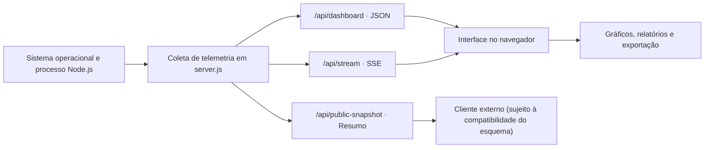

# NEXUS OS Omega V3 — Dashboard de monitoramento

   


## 🎛️ Centro de operações · Observabilidade na prática

> **Objetivo operacional:** investigar o comportamento do host que executa o servidor e interpretar corretamente os dados disponíveis. A trilha abaixo propõe **checkpoints manuais**; não existem testes de missões, placar ou certificações embutidos no dashboard.

| Missão | Competência avaliada | Evidência / experimento | XP didático |
|---|---|---|--:|
| 01 · Inicialização | Subir um serviço HTTP | `npm ci` + `npm start` | 15 |
| 02 · Pulso | Verificar disponibilidade | `GET /api/health` | 20 |
| 03 · Telemetria | Interpretar CPU, RAM e processo Node.js | `GET /api/dashboard` | 25 |
| 04 · Streaming | Inspecionar eventos SSE | `GET /api/stream` | 25 |
| 05 · Comunicação | Exportar JSON e comparar relatórios | [Interface implementada em `server.js`](server.js) | 25 |
| 06 · Análise crítica | Identificar limite do NEXUS LINK v2/v3 | [Explicação técnica](#comparação-com-uma-instância-remota) | 30 |

**Checklist de missão** (para reproduzir localmente, não para marcar como teste automatizado)

- [ ] Executar o serviço no Node.js 18+ e abrir o painel.
- [ ] Inspecionar a resposta de `/api/health`.
- [ ] Explicar o significado e a origem de duas métricas em `/api/dashboard`.
- [ ] Observar pelo menos um evento `telemetry` pelo SSE.
- [ ] Exportar um relatório e localizar o formato `nexus-os-report-v1`.
- [ ] Explicar a incompatibilidade entre `nexus-os-live-v3` e `nexus-os-live-v2`.

<details>
<summary><strong>🏆 Certificação simbólica da trilha: critérios de domínio</strong></summary>

| Selo de aprendizado | Critério verificável |
|---|---|
| 🟦 Operador | Serviço inicializado e endpoint de saúde consultado |
| 🟪 Investigador | Origens de CPU, memória e runtime diferenciadas |
| 🟨 Analista | SSE, histórico em memória e exportação compreendidos |
| 🟩 Auditor | Limites de segurança e incompatibilidade v2/v3 documentados |

Os selos são **metas de estudo**, não badges de CI ou certificados oficiais.

</details>

**🔒 Desafio de produção:** antes de expor o projeto publicamente, avalie os dados de hostname, interfaces e processos que ficam disponíveis sem autenticação. **Não publique capturas com informações sensíveis**.

**📎 Fonte da evidência:** [`server.js`](server.js), [`package.json`](package.json) e as rotas descritas em [Guia de integração da API](#guia-de-integração-da-api).

---

Aplicação em português para acompanhar informações do sistema operacional, do processo Node.js e das requisições recebidas pelo servidor. O projeto usa Express e Helmet e concentra o servidor, as APIs e a interface no arquivo [server.js](server.js).

As métricas correspondem ao ambiente em que o Node.js está em execução. Quando o servidor está na nuvem, o painel apresenta os recursos disponíveis nesse ambiente.

## Conteúdo do repositório

| Arquivo | Conteúdo |
| --- | --- |
| [server.js](server.js) | Coleta de métricas, rotas HTTP, HTML, CSS e JavaScript da interface. |
| [package.json](package.json) | Versão do projeto, dependências, scripts e versão mínima do Node.js. |
| [package-lock.json](package-lock.json) | Versões das dependências registradas pelo npm. |
| [.gitignore](.gitignore) | Regras para ignorar dependências, arquivos de ambiente e logs. |

## Instalação

O [package.json](package.json) declara **Node.js 18 ou superior**, Express e Helmet. Com Node.js e npm disponíveis, execute na raiz do repositório:

```bash
npm ci
npm start
```

O servidor utiliza a porta **3000** por padrão e escuta em `0.0.0.0`. Para escolher outra porta em um terminal Bash:

```bash
PORT=3001 npm start
```

Para reiniciar o servidor automaticamente após alterações em `server.js`:

```bash
npm run dev
```

## Informações apresentadas

| Área | Informações disponíveis |
| --- | --- |
| CPU | Uso médio, uso por núcleo, média e pico recentes, modelo, frequência e carga média. |
| Memória | RAM total, livre e usada; RSS, heap e outras informações de memória do processo Node.js. |
| Sistema operacional | Nome da máquina, plataforma, versão do sistema, arquitetura e tempo de atividade. |
| Runtime | Versões do Node.js e do V8, atraso e utilização do event loop, heap e eventos de coleta de lixo. |
| Rede | Interfaces e endereços identificados pelo módulo `os`. |
| HTTP | Quantidade de requisições, duração média das respostas, classes de status e taxa de erros. |
| Projeto | Quantidade e tamanho dos arquivos da aplicação, com exclusão de `node_modules` e `.git`. |
| Armazenamento | Espaço do volume da aplicação, quando a informação está disponível. |
| Processos | PID, nome, CPU e memória dos processos que o sistema permite consultar. |
| Sessão | Médias, picos, percentis e desvios em relação às amostras recentes. |

A pontuação de saúde e os alertas são calculados por regras definidas no código. Eles ajudam a interpretar o painel, mas não constituem um teste de desempenho controlado.

## Recursos da interface

- Cinco temas: Cyber Cyan, Quantum Violet, Matrix Emerald, Crimson Reactor e Solar Gold.
- Neon suave, intenso ou desligado.
- Modos de observação e apresentação, tela cheia e controle de efeitos visuais.
- Pausa e retomada da atualização.
- Paleta de comandos com `Ctrl+K` ou `Cmd+K`; navegação pelas teclas de seta, execução com Enter e fechamento com Esc.
- Filtro de processos por nome ou PID e ordenação por CPU, memória, nome ou PID.
- Exportação e cópia de relatórios em JSON.
- Importação de dois relatórios para comparação.
- Gravação de amostras no navegador e exportação da sessão em CSV.

Preferências como tema, neon e perfil de atualização são guardadas em `localStorage`. Os relatórios exportados usam o formato `nexus-os-report-v1`.

## Atualização das informações

O perfil padrão utiliza SSE, com envio de telemetria a cada **1,5 segundo**. A interface também oferece perfis de consulta a cada 1, 3 ou 5 segundos. Se a conexão SSE falhar, o código passa a consultar a API periodicamente.

A CPU é amostrada a cada segundo. A lista de processos é atualizada a cada cinco segundos e mostra até 14 itens. Os históricos permanecem em memória durante a execução.

## Rotas HTTP

| Método | Caminho | Resposta |
| --- | --- | --- |
| GET | `/` | Página HTML do dashboard. |
| GET | `/api/dashboard` | Telemetria completa em JSON, com os campos `success`, `timestamp` e `data`. |
| GET | `/api/public-snapshot` | Resumo da telemetria em JSON. |
| OPTIONS | `/api/public-snapshot` | Resposta de preflight com status 204. |
| GET | `/api/stream` | Fluxo SSE com eventos `telemetry` e, em caso de falha na coleta, `fault`. |
| GET | `/api/health` | Estado de disponibilidade do servidor, com `success: true` e `status: "online"`. |

Com o servidor em execução, estas consultas locais permitem conferir as respostas:

```bash
curl --fail --silent http://127.0.0.1:3000/api/health
curl --fail --silent http://127.0.0.1:3000/api/dashboard
curl --fail --silent http://127.0.0.1:3000/api/public-snapshot
```

Ajuste a porta se tiver definido outro valor em `PORT`.

## Comparação com uma instância remota

O painel NEXUS LINK possui um campo para informar a URL de outra instância e consultá-la por meio de `/api/public-snapshot`.

Há uma divergência no código atual: a função `publicSnapshot` produz o esquema `nexus-os-live-v3`, enquanto `fetchRemote` aceita `nexus-os-live-v2`. Assim, duas instâncias desta versão não concluem a conexão remota entre si. A comparação por importação de relatórios JSON utiliza um formato separado.

## Execução no Render

Para o Web Service descrito no material do projeto, use os comandos:

| Configuração | Comando |
| --- | --- |
| Instalação das dependências | `npm ci` |
| Inicialização do serviço | `npm start` |

O servidor lê a variável `PORT`, que pode ser fornecida pela plataforma.

## Apresentação no OBS

O material do projeto propõe usar a página como uma fonte do tipo **Navegador** no OBS Studio. Inicie a aplicação antes de configurar a fonte e use **Interagir** para acessar os controles da página.

## Observações

- Chart.js, Lucide e as fontes da interface são carregados por serviços externos. Sem Chart.js, o código mantém as informações textuais e não cria os gráficos.
- A lista de processos usa PowerShell no Windows e `ps` no Linux. Se a consulta não estiver disponível, o painel mostra apenas o processo Node.js.
- O gerenciador de tarefas permite apenas a consulta de informações: não oferece controles para encerrar processos.
- Ao reiniciar o servidor, os históricos mantidos em memória são descartados.
- Os scripts do [package.json](package.json) são `start` e `dev`; o projeto não define um script de testes.

---

## Arquitetura e fluxo de dados



## Início rápido e acesso

```bash
git clone https://github.com/theroven79-droid/DASHBOARD-MONITORAMENTO.git
cd DASHBOARD-MONITORAMENTO
npm ci
npm start
```

Abra **http://localhost:3000**. Para testar disponibilidade:

```bash
curl http://localhost:3000/api/health
```

**Endereço registrado no material da Aula 07:** [Dashboard no Render](https://dashboard-monitoramento-1.onrender.com/). A existência desse link no material não garante disponibilidade contínua nem prova qual revisão do código está publicada.

## Guia de integração da API

| Caso de uso | Endpoint | Observações |
|---|---|---|
| Verificar se o serviço responde | `GET /api/health` | Não valida a precisão de todas as métricas |
| Consultar um retrato completo | `GET /api/dashboard` | JSON, inclui campos de ambiente |
| Consumir atualizações | `GET /api/stream` | `text/event-stream`; manter conexão aberta |
| Consultar resumo remoto | `GET /api/public-snapshot` | Formato `nexus-os-live-v3` |
| Abrir painel visual | `GET /` | Interface HTML/JavaScript |

### Exemplo de SSE no navegador

```js
const stream = new EventSource("http://localhost:3000/api/stream");
stream.addEventListener("telemetry", event => {
  const message = JSON.parse(event.data);
  console.log(message);
});
stream.addEventListener("fault", event => console.warn(event.data));
```

Este trecho ilustra o consumo de eventos; o formato detalhado do payload pode ser consultado em [server.js](server.js).

## Operação, segurança e limites

- **Exposição de dados:** os endpoints de telemetria não possuem autenticação. Evite publicar indiscriminadamente informações do host, rede ou processos em ambientes sensíveis.
- **Persistência:** os históricos do servidor são mantidos em memória. Exportações de sessão ocorrem no navegador.
- **Compatibilidade remota:** `publicSnapshot` usa `nexus-os-live-v3`; `fetchRemote` verifica `nexus-os-live-v2`. Esta versão requer alinhamento dos esquemas para comparação remota direta.
- **Métricas em nuvem:** descrevem o container/instância onde o Node.js está rodando; não o computador do visitante.
- **Testes:** `package.json` não declara script `test` nem suíte automatizada.

## Referências e rastreabilidade

| Recurso | Fonte |
|---|---|
| Implementação, interface, rotas e regras de coleta | [server.js](server.js) |
| Dependências, scripts e versão de runtime | [package.json](package.json) |
| Deploy Node/Express no Render | [Documentação do Render](https://render.com/docs/deploy-node-express-app) |
| Eventos enviados pelo servidor | [Server-Sent Events (MDN)](https://developer.mozilla.org/en-US/docs/Web/API/Server-sent_events) |
| Instrumentação nativa do Node.js | [Módulo `os` (Node.js)](https://nodejs.org/api/os.html) |
