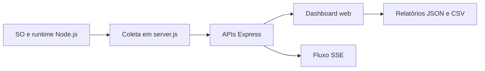

# 📊 NEXUS OS Omega V3 — Dashboard de monitoramento

**Painel de observabilidade desenvolvido em Node.js**, com interface em português para acompanhar métricas do sistema operacional, do processo Node.js e das requisições HTTP recebidas pelo próprio servidor.

[](https://nodejs.org/) [](https://expressjs.com/) 

## ✨ Recursos implementados

| Área | Informações / funcionalidades |
|---|---|
| CPU | Utilização média e por núcleo, clock, carga e histórico recente. |
| Memória | RAM do host e indicadores RSS, heap e memória externa do processo. |
| Sistema | Plataforma, kernel, arquitetura, hostname, uptime e interfaces de rede. |
| Runtime | Versões Node.js/V8, event loop, heap e eventos de coleta de lixo. |
| HTTP | Requisições, tempo médio e distribuição de status do serviço. |
| Processos | Lista de processos visíveis, com filtros; **somente leitura**. |
| Relatórios | Exportação/cópia de JSON, importação comparativa e CSV de sessão. |
| Interface | Cinco temas, neon ajustável, tela cheia, modo de apresentação e `Ctrl+K`. |

Os indicadores e alertas de saúde são **heurísticas definidas no projeto**, não benchmarks independentes.

## 🧱 Arquitetura



O arquivo [server.js](server.js) reúne coleta de dados, rotas HTTP, HTML, CSS e JavaScript da interface. [package.json](package.json) contém dependências e scripts; [package-lock.json](package-lock.json), as versões resolvidas.

## ⚙️ Requisitos e instalação

Node.js **18 ou superior** e npm:

```bash
git clone https://github.com/theroven79-droid/DASHBOARD-MONITORAMENTO.git
cd DASHBOARD-MONITORAMENTO
npm ci
npm start
```

Acesse **http://localhost:3000**. Por padrão, o servidor escuta em `0.0.0.0:3000` e usa a variável de ambiente `PORT` quando definida.

Para desenvolvimento com reinício automático:

```bash
npm run dev
```

O projeto declara Express `^5.1.0` e Helmet `^8.1.0` e não define script de testes.

## 🌐 API HTTP

| Método | Endpoint | Retorno |
|---|---|---|
| `GET` | `/` | Interface HTML do dashboard |
| `GET` | `/api/dashboard` | Telemetria completa em JSON |
| `GET` | `/api/public-snapshot` | Resumo de telemetria (esquema `nexus-os-live-v3`) |
| `OPTIONS` | `/api/public-snapshot` | Preflight HTTP (204) |
| `GET` | `/api/stream` | SSE com eventos `telemetry` e `fault` |
| `GET` | `/api/health` | Status HTTP do serviço |

```bash
curl http://localhost:3000/api/health
curl http://localhost:3000/api/dashboard
curl -N http://localhost:3000/api/stream
```

Os perfis de atualização disponíveis são 1, 1,5, 3 e 5 segundos. O perfil de 1,5 segundo utiliza SSE; a interface pode consultar a API periodicamente se necessário. As amostras ficam em memória durante a execução do servidor.

## ☁️ Publicação no Render

| Configuração | Valor |
|---|---|
| Build Command | `npm ci` |
| Start Command | `npm start` |
| Porta | Fornecida pela variável `PORT` |

**Endereço registrado no material da disciplina:** [dashboard-monitoramento-1.onrender.com](https://dashboard-monitoramento-1.onrender.com/). Não há garantia de disponibilidade contínua ou confirmação de que o deploy utiliza a mesma revisão do código.

## ⚠️ Limitações e segurança

- **NEXUS LINK:** a API remota produz `nexus-os-live-v3`, mas o cliente `fetchRemote` valida `nexus-os-live-v2`. Portanto, duas instâncias desta versão não estabelecem a comparação remota diretamente.
- **Telemetria sem autenticação:** os endpoints expõem informações do ambiente. Avalie o uso em redes e serviços públicos.
- **Medição contextual:** em nuvem, o painel mostra os recursos acessíveis ao processo no host/container, não o computador do visitante.
- **Processos:** enumeração via PowerShell (Windows) ou `ps` (Linux); sem acesso a todos os processos, o painel recua para o processo Node.js.
- **Frontend:** gráficos dependem do Chart.js carregado por CDN; há carregamento externo também de Lucide e fontes.
- **Persistência:** históricos em memória são perdidos quando o servidor reinicia.

## 📚 Referências

- [Código principal](server.js) · [Manifesto npm](package.json)
- [Documentação do Node.js — `os`](https://nodejs.org/api/os.html)
- [SSE — MDN](https://developer.mozilla.org/en-US/docs/Web/API/Server-sent_events)
- [Deploy Node/Express no Render](https://render.com/docs/deploy-node-express-app)
